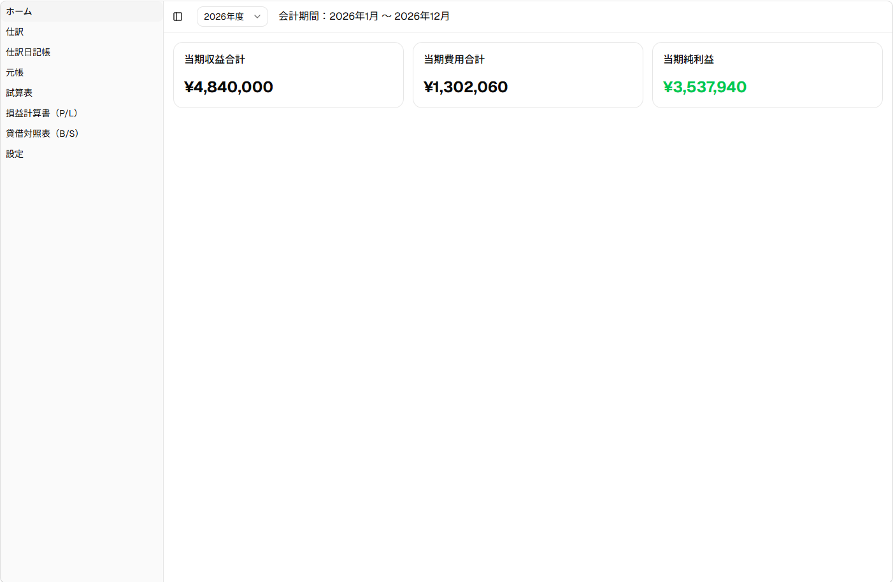
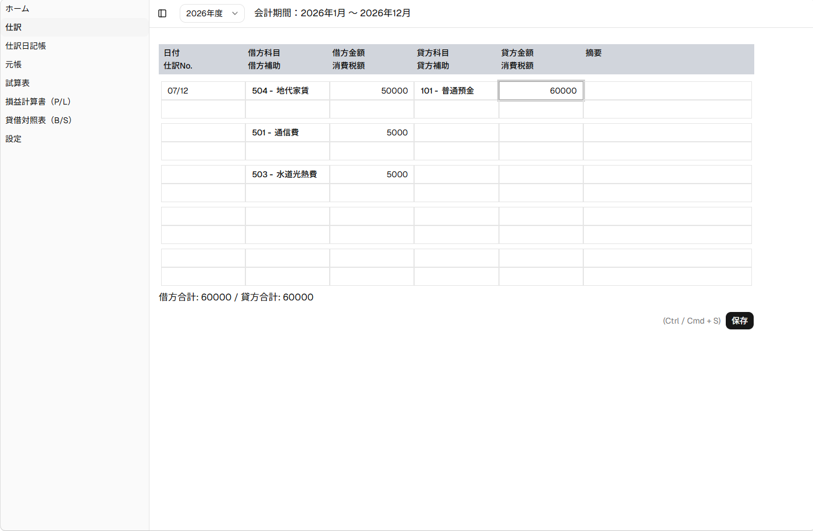
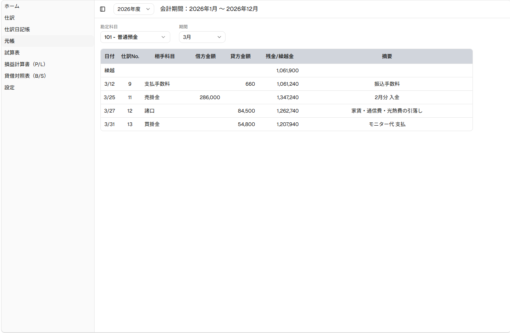

# 会計アプリ(個人事業主向け 複式簿記)

個人事業主向けの、複式簿記で記帳する会計アプリです。経理事務の実務経験と簿記2級の知識をもとに、就職活動用のポートフォリオとして作りました。

**公開URL**: https://accounting-app-plum.vercel.app/





## サンプルデータ

初回はデータが空です。次の手順で、2026年分のサンプル(55件)を読み込めます。

1. [sample-backup.json](https://accounting-app-plum.vercel.app/sample-backup.json) をダウンロードする
2. 画面左のメニューから「設定」を開く
3. 「JSONから復元」でダウンロードしたファイルを選ぶ(現在のデータは置き換わります)

データはブラウザの localStorage に保存され、サーバーには送信されません。

## 主な機能

- 複合仕訳の入力(借方・貸方を複数行、貸借一致の検証)
- Enter で次の項目へ移動、Ctrl + S で保存
- 会計年度と期首月の設定(年度をまたぐ日付を自動で判定)
- 仕訳日記帳(編集・削除)
- 元帳(相手科目、繰越残高、行ごとの残高)
- 試算表(月次推移)、損益計算書、貸借対照表
- JSONでのバックアップと復元
- 画面幅に応じて列や部品を切り替えるレスポンシブ対応

## 使用技術

React / TypeScript / Vite / Zustand / Tailwind CSS / shadcn/ui / React Router / date-fns / Vercel

## 設計の判断

- **入力用と保存用の型を分けた**: 画面は1行に借方・貸方を並べる形(FormRow)、保存は借方明細と貸方明細に分けた形(JournalEntry)にし、保存時に変換しています。
- **年度別に保存**: 仕訳を年度ごとにまとめて保存し、元帳や試算表は選択中の年度だけを集計します。
- **Zustandは複数ページで共有するデータに限定**: 仕訳データと年度設定をストアに置き、入力中のフォームの値は各画面のstateで持っています。
- **保存時の検証を配列にまとめた**: 検証項目を配列(checks)に並べ、先頭から順に最初の失敗だけを知らせます。
- **画面幅の判定は、置かれた場所の幅を基準にした**: サイドバーの開閉で表の幅が変わるため、画面幅ではなくコンテナクエリで列を出し分けています。

## 仕様

- 仕訳Noは年度内の最大値+1で採番します。最新の仕訳を削除すると、その番号は次の登録で再利用されます。
- 前期繰越は、期首月の繰越仕訳として入力する運用です。
- 借方・貸方がともに空の行は、保存時に除かれます。
- 金額は整数で入力します(取り消し仕訳のため、マイナスも入力できます)。
- スマートフォンでは仕訳の入力・編集を想定せず、閲覧を中心にしています。
- localStorage やバックアップを手で編集した場合の動作は対象外です。
- 期首月の変更は想定していません(変更時は確認ダイアログで警告します)。

## 今後の改善予定

- 年度繰越(次年度のデータを生成し、年度の選択肢も自動作成)
- 利用者による勘定科目の追加
- 補助科目・消費税への対応
- スマートフォン向けの簡易仕訳(現在は準備中ページに遷移)
- 一覧の並び替え(日付順 / 仕訳No順)
- 仕訳の複製

## 既知の不具合

- 金額欄で `-` や `1e` だけが残ると、表示と保存値(0扱い)が食い違う
- 会計年度の選択肢が固定(2025〜2029)のため、範囲外の年度はヘッダーの一覧に出ない

## ローカルで動かす

```bash
npm install
npm run dev
```

## 開発について

要件定義・設計方針は自分で検討し、実装時の技術的な問題解決やコードレビューにAIを活用しました。提案されたコードは内容を確認し、アプリの設計方針に合わせて取捨選択・修正しています。